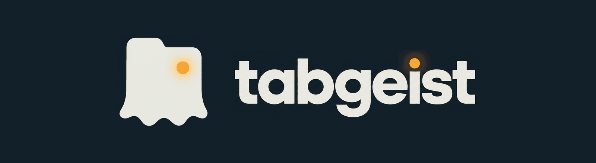

<p align="center">
  
</p>

<p align="center"><b>AI agents in your own browser. You keep the signals.</b></p>

<p align="center">
  <a href="https://www.npmjs.com/package/tabgeist"></a>
  <a href="https://www.npmjs.com/package/tabgeist"></a>
  <a href="LICENSE"></a>
  
  
  
</p>

<p align="center">
  <a href="#quick-start">Quick start</a> ·
  <a href="#how-it-compares">How it compares</a> ·
  <a href="#features">Features</a> ·
  <a href="#packs-a-sites-own-data-not-the-screen">Packs</a> ·
  <a href="#safety">Safety</a> ·
  <a href="CONTRIBUTING.md">Contributing</a>
</p>

Tabgeist lets Claude Code, Codex, Cursor or any MCP agent work in the Chrome or Edge you already use, signed in as you. Risky steps wait for your click, every step leaves a receipt, and a task that worked once becomes a routine that runs again without the AI.

Everything runs on your computer. Nothing listens beyond `127.0.0.1`, and no page, cookie or password goes to a server of ours. There is no server of ours.

<!-- demo: 60 s video goes here -->

## What you can ask for

> "Reply to the last LinkedIn message from Sara, keep it short."
> The agent opens LinkedIn in its own tab, reads the thread, writes the reply. The Send button waits for your click.

> "Search YouTube for 'desi animal comedy' and give me the top 10 with views."
> One call to the YouTube pack: exact titles, channels, views and lengths. Your screen does not move.

> "Every morning, collect the new orders from the supplier portal."
> Done once with the agent, saved as a routine. From then on it runs without the AI, and heals itself when the portal moves a button.

> "Never message Ali on WhatsApp, whatever I ask later."
> One line in that site's rules: `never_to: ['Ali Khan']`. Tabgeist reads who each message goes to from the page and blocks it, even if an agent insists.

## Quick start

Windows 10/11, Node 22+, Chrome or Edge. macOS and Linux should work but are not tested yet.

```bash
npm install -g tabgeist
tabgeist setup
```

`setup` adds Tabgeist to Claude Code, Codex and Cursor (whichever you have), installs its two skills, starts the daemon and opens your browser's extensions page with the extension folder on your clipboard. Then, once:

1. Turn on **Developer mode** → **Load unpacked** → paste the folder.
2. The side panel shows a 6-digit code: approve it in the control room that `setup` opened.
3. Restart your agent and ask it to do something in your browser.

`tabgeist update` installs the newest version and runs `setup` again. Run `setup` any time; it only changes what is missing.

From the source instead: `git clone https://github.com/MuhammadAwais-Automation/tabgeist`, then `npm install`, `npm run build`, `node dist/cli.mjs setup`.

## Why another browser tool

Most browser agents start a fresh, logged-out browser, or drive yours with nobody watching. Tabgeist was built around three questions:

| | Usual browser agents | Tabgeist |
|---|---|---|
| **Which browser?** | A new headless one: log in again, solve captchas | Your own Chrome or Edge, every account already signed in. Agent tabs sit in their own tab group |
| **Who decides?** | The agent, or a prompt that asks it nicely | You. Send, post, pay, delete and upload wait for your click in the browser. The agent cannot approve, and a denied step stays denied |
| **What happens next time?** | The AI does every click again | Save it once as a routine. It replays without the AI, through the site's own data calls where it can. When the site changes a little it finds its way; when it changes a lot, the agent proposes a fix and you decide |

## How it compares

The three tools people most often reach for to let an agent use a real browser, from their own documentation as of October 2026. Something out of date? Open an issue and it gets fixed.

| | **Tabgeist** | [Playwright MCP](https://github.com/microsoft/playwright-mcp) | [Browser Use](https://github.com/browser-use/browser-use) | [Claude in Chrome](https://support.claude.com/en/articles/12012173) |
|---|---|---|---|---|
| Your own signed-in browser | ✅ | ✅ extension mode | ✅ reuses a Chrome profile locally | ✅ |
| Any MCP agent (Claude Code, Codex, Cursor…) | ✅ | ✅ | Python library and CLI | Claude only |
| Risky steps wait for a human, and the agent cannot approve them | ✅ found by what the step does, in many languages | ❌ "not a security boundary" | ❌ not built in | ✅ asks before purchases, deletes, sensitive input; can be switched to act without asking |
| Per-site rules | ✅ block, ask, allow, rate limits, `never_to` recipients | Allowed and blocked origins | Allowed domains | Per-site permissions; admin allow and block lists |
| Block a person, number or email | ✅ read from the page, not from the agent | ❌ | ❌ | ❌ |
| Repeat a task without the AI | ✅ routines, through the site's own API where it can | Records actions as Playwright code | Replays a saved run; extract steps still call the model | Shortcuts are saved prompts the model runs again |
| Repairs itself when the site changes | ✅ small changes on its own, big ones as a fix you approve | ❌ | ❌ stops at the first step it cannot match | ❌ |
| Secrets kept from the model | ✅ found and fogged on every read | Replaces values from a `.env` file ("a convenience, not a security feature") | Placeholders for secrets you pass in | Asks before typing sensitive information |
| A site's own data instead of the screen | ✅ packs | ❌ | Custom tools you write | ❌ |
| Receipts of every step, with a picture after each action | ✅ timeline and a shareable replay | Traces | Run history | — |
| Runs fully on your computer, no account | ✅ | ✅ | ✅ library; cloud is paid | Needs a paid Claude plan |
| License | MIT | Apache-2.0 | MIT | Proprietary |

They are good tools with different aims: Playwright MCP is built for testing and automation, Browser Use for agents you write in Python, Claude in Chrome for chatting with Claude in your browser. Tabgeist is for letting the coding agent you already use work in your real accounts without handing it the keys.

## Features

**Your browser, as it is**
- Works in your everyday Chrome or Edge profile, every account already signed in. Several profiles can be linked at once.
- Agent tabs open in the background in their own tab group, are never discarded, and work while the browser is minimised.
- Reads like a person sees: menus and pickers, iframes, long chats and feeds that only draw what is on screen, emoji and stickers.
- Acts like a person: a real mouse and keyboard for click, type, select, drag, drop and upload. Files the page downloads are saved and handed to the agent.
- Questions only you can answer (codes, PINs, which account) go to you through the side panel.

**You stay in charge**
- Send, post, pay, delete, upload and submit wait for your click in the browser or the control room. They are found by what the step does: the button's words in many languages, the form it submits, the request it makes.
- Approve once, or for the whole site. A denied step stays denied.
- Your own rules per site: `block`, `ask`, `allow`, limits like `send: 5/h`, which other domains a site may send data to, and `never_to`.
- Agents can never open, read or click the control room, and can never change your rules.

**It remembers**
- **Routines**: a task that worked becomes a routine with variables. It runs again without the model, from the control room, the CLI or an agent. Try it first as a dry run that stops before anything is sent.
- **Self-healing**: when a site moves a button, the routine finds the closest match. When the change is bigger, the routine is marked broken, an agent proposes a fix, the fix is dry-run at once, and you approve it.
- **Background checks**: read-only routines can be dry-run on a schedule to notice a site change before you need them.
- **Site notes**: what one agent learned about a site (where things hide, what is slow) is there for the next one.

**It reads the right thing**
- `data: true` gives the JSON the site itself fetched: exact ids, times and full lists.
- Packs read a site's own data in one call, even where the network carries nothing readable.
- Hidden page text (invisible, off-screen, zero-width) never reaches the agent, because that is where pages hide instructions for agents.

**Receipts**
- Every call lands in a timeline per agent: what was asked, what happened, who approved it, and a picture after each action.
- Save any session as one HTML replay to review or attach to a bug report.

**Setup and sharing**
- `tabgeist setup` wires up Claude Code, Codex and Cursor in one go and installs the skills; `tabgeist update` keeps it current.
- Two skills teach any agent the safe way to use the browser and how to build a pack.
- Make a pack for any site with `tabgeist pack new`, share it as a GitHub repository, install anyone's with `tabgeist pack add <URL>`.

## What the agent gets

| Tool | What it does |
|---|---|
| `browser_status`, `browser_tabs`, `browser_open`, `browser_navigate`, `browser_close_tab` | Which browsers are linked; find or open tabs |
| `browser_snapshot` | The page as a short map of controls with refs (`within: "popup"` for menus) |
| `browser_read` | The text people see. `data: true` gives the JSON the site fetched, or a **pack** op: the app's own data |
| `browser_act` | Click, type, select, drag, upload, like a person (real mouse and keys) |
| `browser_screenshot`, `browser_download`, `browser_ask_user` | Pictures, files, and questions only you can answer |
| `routine_save`, `routine_run`, `routine_list` | Turn what worked into a routine; run it again |
| `site_notes`, `site_note` | What earlier agents learned about a site, its pack, and your rules for it |
| `heal_list`, `heal_propose` | Routines a site change broke, and fixes the agent proposes (you decide) |
| `open_control_room` | Opens the control room for you; the agent cannot read or use it |

## Packs: a site's own data, not the screen

Reading the screen is slow and lossy: a page shows what fits, a feed loads as you scroll. Most apps already hold the exact data. A **pack** is a small folder per site that reads it, so the agent gets clean rows in one call and the tab does not move.

| Pack | Reads |
|---|---|
| `youtube` | a video's details, search results, the videos on any page (home, channel, playlist, subscriptions) |
| `hackernews` | story lists, whole comment threads |
| `whatsapp` *(experimental, add it yourself)* | chats and messages without opening them, so they stay unread |

```bash
tabgeist pack                              # packs in use
tabgeist pack new <site> [folder]          # start one, with your saved routines for that site
tabgeist pack try <folder> <url> [op]      # run it on a public page, in a throwaway browser
tabgeist pack add <folder | git URL>       # install or update one
```

Packs only read. Any action still goes through the normal tools and your click. Packs are code that runs in your page, so they come only from you: the ones that ship with Tabgeist, and folders or repositories you add. An agent can call a pack's ops, but it can never install a pack or send its own code. Your own rules, notes and routines for a site always win over its pack.

### Make your own, share it

1. `tabgeist pack new linkedin.com` starts a folder: `pack.json`, a starter `adapter.js`, `notes.md`, and the routines you saved for that site.
2. Ask your agent to fill it in. The `tabgeist-pack` skill teaches it to find where the data lives, write the ops, and test them with `pack try`.
3. `tabgeist pack add <folder>` to use it yourself.
4. To share it, push the folder to a public GitHub repository. Anyone can then run `tabgeist pack add https://github.com/you/tabgeist-pack-linkedin`. Read a pack's `adapter.js` before you add someone else's: it runs in your signed-in pages.

Routines travel the same way: a pack's `routines/` folder. Read yours before sharing, since a routine can hold values you typed.

WhatsApp's terms forbid automation, and accounts have been banned for unofficial clients. The WhatsApp pack only reads, but your account is your risk. That is why it is not on by default.

## Numbers

Measured by `node e2e/run.mjs --bench` in a throwaway Chrome, logged out. Characters are what the agent's model has to read; a token is about four.

| Task | Way | Calls | Size | Time | Got |
|---|---|---|---|---|---|
| Hacker News front page | screen text | 1 | 4.5k chars | 15 ms | 29/30 stories |
| | page map | 1 | 5.8k | 0.25 s | 20/30 |
| | **pack** | 1 | 5.5k | 0.3 s | **30/30**, with ids, links, exact points |
| A 150-comment HN thread | open + read by scrolling | 2 | 32.7k | 4.0 s | 150/150 |
| | **pack** | 1 | 31.8k | **0.7 s** | 150/150, with depth |
| YouTube search, 20 results | screen text | 1 | 7.7k | 0.4 s | 10/20 |
| | page map | 1 | 3.9k | 0.3 s | 4/20 |
| | **pack** | 1 | **3.5k** | 1.1 s | **18–20/20**, with channel, views, length |
| A two-step form task | agent: look, act, check | 3 | 0.7k | 1.7 s | 3 model turns |
| | **routine** | 1 | 0.4k | 2.0 s | **no model turns** when you or a schedule run it |

The honest reading: a pack is not always smaller than the screen, but it is complete, exact and often much faster. The big saving is routines. A model turn re-reads the whole conversation, so a task the agent never has to think about again costs nothing the next hundred times.

## Safety

- **Approvals the agent cannot skip.** Risky steps are found by what they do (the button's words in many languages, the form, the network request), not by asking the agent. They wait for your click in the browser or the control room. Agents cannot open, read or click the control room.
- **Your rules per site.** `block`, `ask`, `allow`, limits like `send: 5/h`, which other domains a site may send data to, and `never_to`: people, numbers or emails nothing is ever sent to. Tabgeist reads who a message goes to from the page itself (the chat's header, the email's recipients), so the agent cannot talk its way past it.
- **Secret fog.** Passwords, one-time codes and card numbers reach the agent as `{{secret:N}}`. It can type one back on the same site, never elsewhere.
- **Data does not wander.** Text read on one site cannot be sent to another without your yes. Hidden page text never reaches the agent.
- **Receipts.** Every step lands in a timeline with what was asked, what happened, who approved it and a picture after each action.

What it does not protect against, and why: [`docs/architecture.md`](docs/architecture.md).

## Where your data lives

Plain files in `~/.tabgeist` you can read, edit and back up: `sites/<site>/` (your rules, notes, routines, health), `packs/`, `timeline/`, `shots/`, `heal/`. The control room (`tabgeist open`) shows all of it.

## Develop

```bash
npm install
npm test            # unit tests
npm run typecheck
npm run build       # dist/cli.mjs and the control room
npm run e2e         # the real extension in a throwaway Chrome, never your profile
```

How the pieces fit and the threat model: [`docs/architecture.md`](docs/architecture.md). The design system: [`design/README.md`](design/README.md). Packs, fixes and bug reports: [`CONTRIBUTING.md`](CONTRIBUTING.md).

## License

[MIT](LICENSE)
